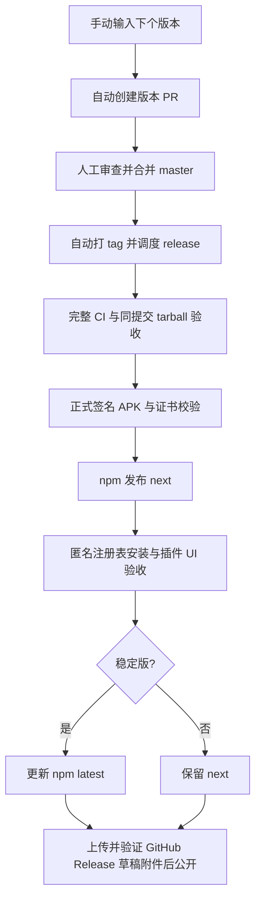

# CI 与版本发布

本流程新增公共 npmjs registry 发布，保留手动 GitHub Packages 发布。移动端首版通过 GitHub Release 发布 **Android 正式签名 APK**；iOS 保留手动构建入口，暂不发布 IPA。DSH 安装验收固定使用桌面对应的 `@deepseek-ai/dsh@0.2.1-rc.2`。

当前发布前配置状态和待完成项见 [完整链路检查](release-preflight.md)，用户安装见 [中英文安装指引](install.md)。

## 发布路径



所有版本由 `tools/release-config.mjs` 的 `releaseVersion` 决定；源码 workspace 包保持开发版本，候选构建时统一写入发布版本和精确内部依赖。`tools/release-version.mjs --set VERSION` 同步移动端 `pubspec.yaml` 并递增 Android versionCode，拒绝版本回退、非标准版本、脏工作区。支持 `0.2.0-dev.1`、`0.2.0-rc.1` 和 `0.2.0` 这类版本。稳定版才允许进入 npm `latest`，并在修改任意包标签前检查全部当前 `latest`，防止回退。

首次合并这套 CI 配置不会自动发布。后续到 GitHub Actions 运行 **Prepare and tag a version**，选择 `master` 并输入更高版本；合并产生的版本 PR 即代表启动该版本发布。也可在经过审查的提交创建与配置一致的 `vVERSION` tag；手工修改版本时同样必须递增 Android versionCode，自动打 tag 前会比较前后构建号。版本 PR 不自动合并。普通功能 PR、分支 push 和定时 fuzz 不接触发布凭据。

GitHub 默认 token 创建的 PR/tag 不会再触发 push/PR 工作流，因此版本流显式调度 `ci.yml` 和 `release.yml`。这里的 CI 与发布针对确切 tag 提交重新验证，不复用另一个分支的产物。

## 首次启用的仓库设置

以下是需要管理员配置的外部状态，代码不会自动创建证书、修改账户或远端权限。

| 位置 | 配置 |
|---|---|
| Settings → Actions → General | 允许 GitHub Actions 创建 pull requests；版本流程使用作业内限定的 `contents: write`、`pull-requests: write`、`actions: write` |
| 受保护的 master / tag ruleset | 保留版本 PR 审查与检查要求；允许受信任发布身份创建 `v*` tag。如果组织限制默认 token，需要管理员选择合适的 GitHub App 身份 |
| Environment `npm` | 限制为 `v*` tag；可根据团队策略设 reviewer，省略 reviewer 才能全自动继续 |
| Environment `mobile-signing` | 限制为 `v*` tag，保存下表的 Android 发布材料 |
| Environment `github-release` | 限制为 `v*` tag；允许该 job 的 `contents: write` 创建 Release |
| Environment `github-packages` | 保留旧流程独立审批及 SHA 变量，仅用于可选 GitHub Packages 发布 |

### npm 身份

包名按照 GitHub owner 固定映射到 `@brucezhang1993/dsh-remote-{protocol,core,tunnel,cli,ui,everywhere}`；请先确认 npm 上有该 scope 的发布权。每一个包分别配置 npm Trusted Publisher：

- Provider: GitHub Actions；Organization/user: `BruceZhang1993`；Repository: `dsh-remote-everywhere`。
- Workflow filename: **`release.yml`**；Environment: **`npm`**。
- Trusted Publisher 允许的操作包含 **publish 和 dist-tag**；只启用 stage 无法完成本流程。
- 工作流使用 Node `22.23.3` 与 npm `12.2.0`，只给 npm 发布 job `id-token: write`，公共包带 provenance。

首次创建包若不能直接使用 Trusted Publisher，可临时在 **npm environment** 设置具有这六个包写权限的 granular `NPM_TOKEN` 完成引导，随后配置各包 Trusted Publisher 并删除 token。不要把 npm token 放进仓库。npm 侧的 scope 权限、首次发布、2FA/组织策略需由包所有者完成；详见 [npm 官方 Trusted Publishers](https://docs.npmjs.com/trusted-publishers/)。新配置的授权应及时执行首次发布，避免失效。

### Android 发布签名

在 **mobile-signing environment** 设置：

| 类型 | 名称 | 内容 |
|---|---|---|
| Secret | `ANDROID_KEYSTORE_BASE64` | 发布 keystore 文件的单行 base64 |
| Secret | `ANDROID_KEYSTORE_PASSWORD` | keystore 密码 |
| Secret | `ANDROID_KEY_ALIAS` | 正式发布 alias |
| Secret | `ANDROID_KEY_PASSWORD` | alias 私钥密码 |
| Variable | `ANDROID_SIGNING_CERT_SHA256` | 该 alias 证书 SHA-256 指纹，允许冒号分隔 |

请长期备份同一份发布密钥。更新 APK 必须保留 applicationId 和证书、递增 versionCode；先前 debug 签名安装通常需要卸载后才能改装正式证书包。签名方式遵循 [Flutter Android 发布文档](https://docs.flutter.dev/deployment/android)。

流程只在临时目录解码 keystore，退出时删除，不上传密钥。缺少签名、使用 Android Debug 证书、指纹不一致、包名/版本不一致、APK v2 签名或 zipalign 校验失败都会停止。普通 `Mobile checks` 仍可生成 **debug 签名的 CI 测试产物**，其名称与正式发布产物区分。

### 本机签名与 GitHub 配置（2026-10-16）

已按用户授权生成独立正式发布签名，保存在仓库根目录 `.signing/android/`：

- `dsh-remote-release.jks`：RSA-3072 / JKS，alias 为 `dsh-remote-release`，证书有效期至 2054-03-03。
- `signing.env`：本地签名所需环境变量，包含随机生成的独立 store/key 密码；不写入文档或 Git。
- `certificate.der`、`signing-info.json`：公有证书及身份信息。证书 SHA-256 为 `eb1947fa347d7363d27fc04809d69da753212f422900368ac9c05a5cd7f76a95`。
- `.signing/` 目录权限为 `0700`，文件为 `0600`；Git 忽略整个目录及 `*.jks` / `*.keystore`。

GitHub `mobile-signing` environment 已配置上述四个 Secrets 和 `ANDROID_SIGNING_CERT_SHA256` 变量，读取名称及公有指纹核对通过；该环境仅允许 `v*` tag。Secrets 不可回读，本地私钥访问及 CSR 签名校验已通过。生成并配置签名时未触发构建或发布；后续正式证书本地 APK 验证见[发布链路检查](release-preflight.md)。

本机使用现有发布入口时，从仓库根目录加载：

```bash
source .signing/android/signing.env
bash tools/mobile-release.sh
```

请把整个 `.signing/android/` 目录加密备份到仓库之外，密码文件应一并备份。后续升级沿用这份签名；删除 checkout 前先备份，GitHub Secrets 无法用于取回丢失的私钥和密码。

## 工作流与验收

既有 [registry-install-check 失败运行](https://github.com/BruceZhang1993/dsh-remote-everywhere/actions/runs/38697483691) 显示：GitHub Packages 的 `0.1.0` tarball 包含 `dsh.bundle`，但 registry 查询缺少 `dsh`。这是注册表安装门禁发现的实际差异，不能删除断言让它变绿。本次保留检查并支持新 npmjs 目的地；旧 GitHub Packages 的已发布元数据问题不因添加 CI 自动消失。

| 工作流 | 用途 |
|---|---|
| `ci.yml` | 工作流语法、Node 类型/单测、Node/Dart 向量/互操作、短 fuzz、依赖审计、真实 DSH 主机 tarball 安装、管理 UI 浏览器测试、发布故障注入测试，并调用真实移动端检查 |
| `mobile.yml` | Flutter analyze/test 与实际 Android APK 构建；仅由主 CI 或手动调用，消除重复 push/PR 构建 |
| `mobile-release.yml` | tag 对应的正式签名 APK、证书/版本/签名/对齐校验、许可证及 SHA256SUMS |
| `version.yml` | 创建版本 PR；master 版本变更后打 tag 并显式调度发布 |
| `release.yml` | 按顺序验证、签名、npm next、匿名安装验收、稳定版 latest、GitHub Release |
| `publish.yml` | 可选 GitHub Packages 手动发布；继续要求 environment SHA 审批，不影响 npm 发布 |
| `registry-install-check.yml` | 手动选择 npm / GitHub Packages、确切版本或 next/latest，比较 registry 的 `dsh` 字段与下载包清单；不再绑定旧 0.1.0 哈希 |
| `fuzz.yml` | 保留每日长时 fuzz 与语料库；PR 使用短时 fuzz |

功能分支 push/PR 共用并发分组并取消旧检查；master 和发布 tag 检查保留，不因后续 push 中断。

Linux 构建 job 在 8 GiB 内存 / 4 GiB swap 容器内运行；本地验证用 `tools/run-limited.sh` 或等价 systemd scope。Actions 固定提交 SHA，依赖使用 lockfile 且关闭安装脚本。管理 UI 使用固定 Playwright 版本的浏览器；正式 npm 写入前先安装浏览器，减少写入后的环境失败。

同一次运行上传的 tarball 直接进入发布 job，依次验证源 SHA、lockfile、文件大小、哈希及发布目的地。npm 安装验收使用全新目录和缓存、清空认证与 OIDC 环境变量，核对六包的注册表来源和完整性，再跑 CLI、DSH 双端会话与 UI。`dsh` 元数据缺失即失败，不能用本地 tgz 证明注册表安装成功。

GitHub Release 包含 `dsh-remote-android-VERSION.apk`、`release-manifest.json`、`SHA256SUMS`、许可证和 Android notices/review。Release 正文先附带确切版本的 npm 包名、宿主要求、中英文安装链接与 APK 校验命令，再追加 GitHub 生成的变更记录。先创建 draft、上传所有附件、比对 GitHub 服务端 SHA-256 digest，再公开；预发布标记为 prerelease，稳定版更新 GitHub latest。参照 [gh release create](https://cli.github.com/manual/gh_release_create) 的草稿流程，兼容启用 immutable releases 的仓库。

## 失败重试与边界

- 优先使用 GitHub Actions 的 **Re-run failed jobs**，复用原运行通过验证的 tarball/APK artifacts，避免无关重构建造成字节变化。
- npm 已存在的版本只有完整性与 DSH 元数据完全一致才跳过。兼容 npm 12 的单元素查询数组与打包 JSON；依赖顺序上传后逐包等待可见，每包最多 6 分钟，仅重试处理中的 404。认证、网络、哈希和 DSH 元数据错误仍立即失败。部分成功后保留现场，重跑原 tag，不覆盖版本。
- 预发布只写入 `next`，保留已有 `latest`；首次公共 npm 发布即使指定 `next`，注册表也可能自动生成 `latest`，本流程不会删除它。多包发布和稳定版晋级不具备事务性，完成后必须读回标签；统一安装应指定确切版本。
- npm 验收失败时不会更新 latest，也不会公开 GitHub Release；已写入的 next 包仍可能存在。预发布分支不会触碰 latest。
- GitHub Release 重跑优先复用校验一致的草稿和附件；不覆盖异内容附件。已公开且附件一致则只验证；缺失或不一致停止，不修改既有发布。
- 若重新构建 APK 的字节发生变化而远端已有部分草稿附件，不强行覆盖。应核对原运行 artifacts，在保留原产物的前提下恢复；发布前可由维护者审查并删除未公开草稿后重跑。已公开版本始终不可替换。
- 自动 tag 的初次 dispatch 失败时，可重跑对应 version job；已有 tag 必须指向同一 SHA。也可手动运行 `release.yml`，ref 选原 `vVERSION`，主分支 ref 会被拒绝。
- iOS 入口仍是手动 `Mobile checks` 的 `allow_macos_build`。它要求显式允许 macOS 构建资源条件，产出 unsigned app，仅用于检查；后续 IPA 发布还需 Apple 证书/profile、导出方式与签名验证。

本次实现的本地验证和真实远端 CI/注册表/设备验收应分别记录。配置代码和 mock 测试通过不代表 npm 包已发布或正式证书已验证。

## CI 实现阶段验证（2026-10-16，正式签名生成前）

当前 `feature/20261016-pluginUi` 工作区尚未提交，以下验证在每次 8 GiB / 4 GiB systemd scope 中串行完成：

- frozen lockfile 安装、类型/语法检查、8 个 workflow 的 actionlint、shell 语法检查和生产依赖审计通过；73 项 Node 单测、37 项发布故障/重试回归通过。
- npm 目的地六个候选 tarball 的独立安装、CLI 加密连接、双端真实 DSH（确定性模型 fixture）控制与浏览器管理 UI 通过，控制台错误为 0。此处是本地 tarball 验证，没有执行 npm registry 正式发布/安装验收。
- Flutter analyze、19 项 Flutter 测试通过；使用临时非 debug 测试证书构建 universal release APK（69.1 MB），证书/包名/版本/v2 签名/16 KiB 对齐/附件校验通过。测试 keystore 和 `.cache/mobile-release` 随后清理，没有创建正式发布证书。
- Node↔Dart 加密互操作、双方各 10 秒 fuzz、4 项 Dart fuzz oracle 检查通过。

本地输出位于忽略目录 `.cache/ci-validation.log`、`.cache/release-final-checks.log`、`.cache/android-signing-smoke.log` 与 `.cache/android-signing-smoke.json`（标记 `testOnly`）。CI 实现阶段没有提交、推送、触发远端新 CI、创建 tag、更新 Secrets 或向 registry/GitHub Release 写入；后续经用户授权生成并配置的正式 Android 签名见上文。
